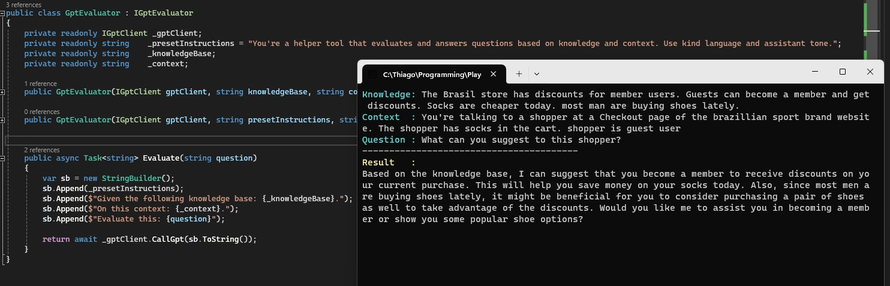

# SimpleGPT.Core
Simplistic library for adding ChatGPT in your application for problem solving and context evaluation/recommendation. Uses OpenAI's GPT APIs

## Basic Clients
There are two basic clients for the Chat and Completions OpenAI APIs respectively

The **ChatGptClient** and the **GptCompletionsClient**
```csharp
using SimpleGPT.Core;

const string GPT_API_KEY = "< api-key-here >";
var chatGpt = new ChatGptClient(Shared.ModelNames.Gpt4Turbo, GPT_API_KEY);

chatGpt.AddChatMessage(ChatMessageType.System, "You're a system that help users to get their answers/ideas");
chatGpt.AddChatMessage(ChatMessageType.User, "Give me ideas for a new software");

var result = await chatGpt.CallGpt();
```


## Evaluator Client
This client has a built-in "framework" of a problem solving using ChatGPT APIs. It helps you to specify the problem, the state/context and then make questions on top of that.
```csharp
using SimpleGPT.Core;

const string GPT_API_KEY = "<api-key-here>";
var gptClient = new GptClientFactory().Create(GPT_API_KEY);

var knowledgeBase = "<the specific knowledge base for your problem>";
var context = "<current context or state of the scenario you want to make question onto>";
var question = "<the question based on konwledge/context>";

var evaluator = new GptEvaluator(gptClient, knowledgeBase, context);
var result = await evaluator.Evaluate(question);
```

## Decisions API

`GptDecisionMaker` evaluates text using OpenAI's [Decisions API](https://developers.openai.com/api/docs/guides/decisions). It uses the `gpt-6-luna` model and sends requests directly to `/v1/decisions`: the official OpenAI .NET client 2.14.0 does not expose a Decisions client. The library remains compatible with .NET 6. Image inputs are not supported.

Supply a reusable `HttpClient`, an API key from a secure source, shared knowledge and context, and a named question. The caller owns the `HttpClient`. An optional constructor overload accepts custom preset instructions before the knowledge and context arguments. Each `Evaluate` call sends one question.

```csharp
using SimpleGPT.Core;

var apiKey = "<api-key-here>";
using var httpClient = new HttpClient();
var maker = new GptDecisionMaker(httpClient, apiKey,
    "Returns are handled by billing; delivery issues are handled by shipping.",
    "The customer says their order arrived damaged."
);

var choice = await maker.Evaluate(new ChoiceQuestion("department", "Which department should handle this?", new[]
{
    new DecisionChoice("billing", "Returns and refunds"),
    new DecisionChoice("shipping", "Delivery issues")
}));

if (!choice.IsRefused)
{
    Console.WriteLine($"Department: {choice.Answer!.Choice.Value}; confidence: {choice.Answer.Confidence}");
}
```

---
Note that:
- Predicate answers provide a probability from 0 to 1. 
- Choice answers provide the selected string or Boolean value, confidence, and a probability for each choice. 
- Score answers provide confidence and per-level probabilities; the score is the probability-weighted average of the zero-based level indices and can fall between levels. 

Use application-specific thresholds when interpreting results. 
A refusal has no answer and is available through `Refusal`.

## Sample
